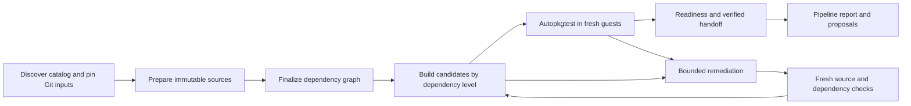

# Packaging executor architecture

Packaging tools build Debian packages. This application chooses pinned inputs,
checks the resulting artifacts, and preserves evidence at each boundary.

## Two entry paths

`packaging build --plan LOCK` executes a reviewed schema-v1 lock. It performs no
release discovery. `packaging plan` remains an advisory discovery interface.

The nightly path discovers a catalog, pins upstream and packaging commits,
prepares immutable sources, and derives a dependency graph from their metadata.
The GitHub workflows orchestrate this path through compatibility scripts that
call importable package modules.

Source-preparation failures have a separate remediation path before graph
finalization. During package remediation, a newly introduced selected build
producer outside the frozen graph requires replanning. Broader runtime/test
relationship replanning after repairs remains a limitation.

## Ownership

| Area | Owner | Boundary |
| --- | --- | --- |
| Advisory release planning | `cli`, `planner`, `release_discovery` | User configuration to advisory plan |
| Source discovery | `nightly_plan.SourceDiscovery` | Catalog roots to pinned upstream dependency closure |
| Nightly scheduling | `nightly_plan.CatalogScheduler`, `final_plan`, `prepared_plan.DependencyPlan` | Selected catalog and prepared metadata to dependency waves |
| Plan publication | `nightly_plan.PlanPublisher` | Catalog and plan to hashed artifacts and workflow summaries |
| Dependency syntax | `relations.BuildContext`, `DependencyRelation` | Target-aware restriction evaluation |
| JSON identity | `contracts.BuildTarget`, `PreparedSource` | Validated immutable identity records |
| Source orchestration | `nightly_source.SourcePreparer` | One workspace, command log, and preparation result |
| Quilt policy | `patches` | Evidence for applied patches and review suggestions |
| Locked execution | `locked.LockedBuild`, `commands.CommandRunner` | Lock to validated source/binary artifacts |
| Artifact handoff | `handoff.ProducerBundle`, `collect_producers` | Same-run producer identity, readiness, and byte verification |
| Remediation evidence | `remediation_evidence` | Ordered, bounded logs and source excerpts |
| Package remediation | `ProposalPlanner`, `CandidateExecutor`, `ArtifactPromoter` | Validated decisions, isolated build/test gates, and canonical artifact replacement |
| Retry coordination | `RepairProgress`, `RemediationSession` | Attempt records, unchanged-evidence retries, and budgets |
| Source remediation | `source_remediation` | Repairs before immutable source preparation |
| Reporting | `pipeline_report`, `packaging_proposal`, `failure_summary` | Evidence to human-readable reports |

Objects own state and invariants. `LockedBuild` accepts an injected
`CommandExecutor` protocol for process-boundary tests. Parsing, hashing, graph transformations, and
version calculations remain functions. No generic plugin framework or class
hierarchy is needed. JSON remains the interchange format; typed records are
used at identity and policy boundaries while preserving artifact schema
compatibility. The handoff module constructs repositories for verified candidate
packages.

## Execution and evidence

The locked executor preflights the named schroot and tools, obtains pinned
source inputs, verifies the `.dsc` and its components, runs sbuild, checks actual
binary metadata and checksummed `.changes`/`.buildinfo`, then runs Lintian.
A successful command without the required artifacts is a failed build.

Command logs retain full stdout/stderr on disk and bounded tails in JSON.
Deadlines cover the entire subprocess lifetime, including time after its pipes
close. Build manifests use atomic replacement. Failures retain the stage,
packaging files, command details, and relevant Git evidence.

The standalone regression wrapper runs a fresh installation check after the
build. Nightly jobs use autopkgtest and a producer-readiness record. Build
success alone does not authorize downstream handoff; see the
[result contract](docs/contracts.md).

## Packaging changes and trust

Packaging Git commits and source checksums are pinned before execution.
Generated sdists use pinned build tools and normalized archive headers.
Fallback packaging sources and their reasons are recorded explicitly.

Quilt identifier overlap is advisory. It never comments out a patch in `series`.
A failed active patch continues to fail source validation. Existing reverse-apply
and matching upstream Change-Id policies are separate mechanisms, with their
own recorded evidence; their assumptions are not semantic equivalence proofs.

Model output is untrusted. Deterministic validation restricts repair paths and
rejects known test-bypass patterns, but text checks are not a security sandbox.
Run source generation, packaging rules, builds, and tests in disposable builders
without publication credentials. A proposed repair is promoted only after its
fresh build and accepted autopkgtest outcome; all attempts retain evidence.
Human-review flags describe proposal review, not a guarantee that review has
already happened.

## Reproducibility and scope

Equal locks do not promise byte-identical binaries. Archive dependencies are
current at build time and recorded, rather than served from immutable snapshots.
The locked executor does not independently authenticate archive `.dsc`
signatures. Same-run handoff verifies identity and bytes but is not a signed
public archive. No automatic signing, Launchpad upload, or regress-stack gate is
connected. Current operational targets and schedules belong in the
[nightly reference](HIBISCUS-PIPELINE.md), not duplicated here.
