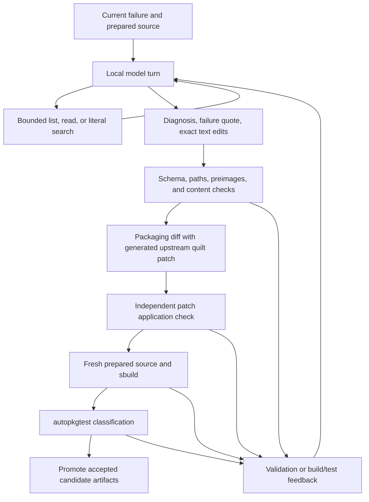
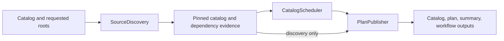
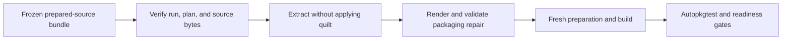

# Pipeline contracts

## Identity records

The executable lock and prepared-source manifest currently use `schema_version: 1`.
Readers reject unsupported versions. Additive diagnostic fields may be introduced
without changing identity semantics. Renaming required fields or changing their
meaning requires a schema revision and reader migration; do not rewrite old evidence.

`PreparedSource` validates source name, version presence, basename-only `.dsc`,
and SHA256 fields. Consumers additionally check the catalog-entry digest, Git
pins, run ID/attempt, source inventory, and actual file hashes. No checksum stored
alongside an artifact is by itself proof of an independent trust root.

`BuildTarget` validates suite, architecture, distribution, and immutable profile
names. Snapshot catalogs retain additional target fields for UCA and builder
configuration. Suite and upload distribution are distinct.

## Typed metadata boundaries

Runtime parsers validate JSON shapes before typed planning or verification code
uses them. `TypedDict` records preserve dictionary-based JSON schemas; dataclasses
own build context and execution state. Type annotations alone do not validate
JSON loaded from an artifact.

| Record | Fields and validation |
| --- | --- |
| `ControlMetadata` | String-valued build fields, binary control stanzas, and autopkgtest stanzas |
| `PreparedMetadata` | Source, version, declared binary names, control metadata, and test triggers |
| `PreparedManifest` | Prepared metadata plus version-one descriptor identity, source inventory, Git pins, packaging origin, and CI identity |
| `SourceArtifact` | Unique bundle-relative filename and lowercase SHA-256 digest; paths and backslashes are rejected |
| `ActiveRelation` | Package, optional operator/version, active expression, and original alternative group |
| `ArchiveDecision` | `decision: ubuntu-archive`, consumer, phase, location, binary, source, version, and relation |
| `SystemDecision` | `decision: system-archive-resolution`, consumer, phase, location, candidate binary names, and relation |
| `DependencyError` | Unsatisfied relation, consumer source, phase, location, and selected candidate sources |
| `ProducerBinary` | Verified binary identity, reconstructed local path, producer lock digest, source, and CI identity |
| `SnapshotSelection` | Resolved branch and commit, release base, nullable cutoff, timestamp, versions, and ordered commit inventory |

`prepared_manifest()` requires arrays for binaries, stanzas, and source artifacts.
It rejects non-string dependency declarations, malformed digests, duplicate
artifact names, and non-string CI values. Optional binary and test declarations
normalize to empty strings. Git pins may be null where no packaging Git revision
exists; packaging origin and CI identity retain their existing nullable schema.
Bundle consumers still verify provenance and actual bytes independently of shape
validation. Additive unknown manifest fields are ignored by the typed reader.

`ExactDependencyResolver` captures detached metadata and archive evidence at
construction. A successful resolution is cached; every caller receives an
independent copy of the resulting graph and its decision records.

Quilt evidence uses separate records for proven applied patches, forwarded
integration evidence, and heuristic overlap suggestions. Only the first two
policies can omit series entries; overlap evidence remains a review suggestion.

## Dependency decisions

Relations preserve alternatives and version operators. Architecture restrictions
use `dpkg-architecture` against the target, not the planner host. Profile terms
within `<...>` are ANDed; separate groups are ORed. Unknown syntax fails planning.
Recognized dpkg/autopkgtest substitutions remain deferred to those tools.

Version comparisons use `dpkg --compare-versions`. A satisfying selected candidate
is preferred; otherwise known archive versions are considered. Unknown external
providers remain an explicit system-archive resolution decision. Virtual Provides,
full Multi-Arch provider selection, and unresolved substvars are not a complete
APT solver and must not be described as such.

Every selected candidate edge records its phase, declaration, and producer.
Cycles retain explicit archive bootstrap decisions. A bootstrap build does not
prove that every package was built against the complete candidate set.

Package remediation must not introduce an unplanned selected build producer.
That case fails with a request to regenerate the plan. Post-repair runtime/test
replanning is not yet complete; this limitation remains on the roadmap.

## Results and promotion

| Record | Meaning |
| --- | --- |
| `PLANNED` | Lock validated without executing a build |
| Build `SUCCEEDED` | Source/binary checks and Lintian gate passed |
| Autopkgtest `PASS` | Reported tests passed |
| `SUPERFICIAL`, `SKIP`, `NO_TESTS` | Distinct coverage limitations accepted by current handoff policy |
| `FAIL`, `INFRA_ERROR`, `BLOCKED` | Failed test or unavailable prerequisite; not readiness |
| Producer `READY` | Successful build and an accepted test outcome for the expected run |
| Remediation `REPAIRED` | Fresh candidate build/test accepted and selected for promotion |

Proposal validation currently accepts PASS, SUPERFICIAL, and NO_TESTS; unlike
handoff readiness, it does not mark SKIP as validated. Preserve this distinction
until the review policy is deliberately changed.

A review suggestion does not mean a patch was applied. In particular,
`review-upstream-patch-overlap` records heuristic evidence while leaving the
quilt series unchanged. Proposals retain `human_review_required` until reviewed;
the flag does not serve as an execution approval mechanism.

## Compatibility

Scripts are command-line adapters. Import reusable Python APIs from
`packagetest`. The advisory `packaging plan` CLI and the candidate handoff
repository builder serve separate planning and execution responsibilities.

## Package remediation responsibilities

Evidence selection preserves priority: missing-import build dependencies, failed
quilt patches and focused upstream hunks, implicated functional tests, then
packaging files and moved-path candidates. Source context shares one character
budget; model prompts also retain bounded feedback from the preceding attempt.

`ProposalPlanner` normalizes, validates, and batches model decisions, then renders
a cumulative patch against the original prepared tree. Decision identities are
counted before rendering, and accepted changes are retained when a failed build
or test exposes a different failure. An unchanged failure discards the ineffective
proposal and allows a different proposal within the unchanged-evidence retry
budget. Repeated decisions stop the session.

`CandidateExecutor` runs a fresh build followed by autopkgtest only when the build
returns zero and records `SUCCEEDED`. Test acceptance uses the classified result;
the raw test exit code is recorded separately. It never replaces canonical output
directories. `ArtifactPromoter` accepts only a candidate with successful build
and accepted test outcomes and performs the canonical directory replacement.
Replacement is sequential, not a transaction across both directories.

`RepairProgress` records attempts and unchanged-evidence retries;
`RemediationSession` supplies wall-clock and attempt budgets. Model timeouts keep
partial output and stop immediately, subprocess timeouts stop the session, and
other errors use the unchanged-evidence retry budget. Report rendering does not
make execution or promotion decisions.

### Local model investigation and edit protocol

The model can return `inspect`, `propose_patch`, or an existing mechanical repair
decision. Inspection consumes a model call but no rebuild or validated-repair
slot. Every prompt, response, inspection result, diagnosis, patch validation,
rebuild result, and test result is retained in the attempt evidence.



Inspection requests use this envelope:

```json
{"action":"inspect","requests":[{"op":"read","path":"package/worker.py","start":1,"lines":80}]}
```

| Operation | Fields | Bound |
| --- | --- | --- |
| `list` | `path`, optional one-based `start` | 100 directory entries per page |
| `read` | `path`, optional one-based `start` and `lines` | 120 numbered lines; 256 KiB UTF-8 file |
| `search` | `path`, `query` | Literal query up to 200 characters; 30 matches; 5,000 files per directory subtree |

Each turn accepts 1–3 requests and returns at most 8,000 characters
of JSON, with explicit truncation markers. Paths stay inside the source tree;
symlinks, traversal, ambiguous names, private Git/quilt state, and generated
build directories are rejected. Inspection cannot run commands, access the
network, or inspect the runner environment. Narrow the directory or line range
when feedback reports a limit. Source content and diagnostics are untrusted data.

General repairs use this envelope:

```json
{"action":"propose_patch","diagnosis":"Explain the failed invariant and the correction","evidence":"Exact current failure quotation","edits":[{"path":"package/worker.py","before":"exact unique existing block\n","after":"replacement block\n"}]}
```

`PatchPlan` requires a verbatim quotation from the current failure and 1–8 unique
file edits. Responses are limited to 48 KiB; duplicate JSON fields are rejected.
The parser accepts a single action object in plain output or a JSON Markdown
fence, including llama.cpp banners, its truncated prompt preview, and its exit
message. Prompt examples are discarded before decoding. Multiple actions,
nested action envelopes, duplicate fields, and malformed final responses are
rejected; the parser does not fall back to an earlier proposed action.
A nonempty `before` must occur exactly once. Empty `before` creates a previously
absent file. Files remain nonempty UTF-8 text ending in a newline. Direct edits
cannot change changelog, source format, source options, maintainer hooks, or
quilt bookkeeping. Packaging ownership and test-bypass checks also apply.

For upstream edits, the harness materializes the current `3.0 (quilt)` stack in
a disposable copy, generates a deterministic new DEP-3 quilt patch, and appends
it to `debian/patches/series`. The outer proposal changes only Debian packaging.
Inspection after an accepted prefix sees its applied upstream changes. A broken
existing quilt stack must first be repaired through the mechanical refresh/drop
interface; generic edits cannot bypass that stack or modify its patch files.

The semantic admission rules are implemented in `repair_policy`. They run against
complete before/after files during exact-edit rendering and again at the
independent `validate_source_patch` gate. The patch gate first applies the outer
diff in disposable storage. New quilt payloads affecting policy files are applied
in another disposable source view, including earlier newly generated patches in
the proposed series. Policy rejection leaves the original source untouched,
including when `apply=True` was requested. Source code remains inert during
validation; Git and Debian's source tool only apply patches.

| Boundary | Accepted automatically | Rejected for automatic application |
| --- | --- | --- |
| Existing Python tests | Original syntax and execution setup preserved; additional nonvacuous assertions and independent regression functions | Changed assertions, fixture inputs, decorators, defaults, helpers, constants, class inheritance, removed tests, or shadowing definitions |
| New Python regressions | Direct assertions or unconditional unittest assertion contexts | Literal/self comparisons, Boolean literal escape hatches, assertions only inside uncalled helpers or conditional branches, dynamic skips, early returns, or exception suppression |
| Test collection and tooling | Unchanged effective configuration | Collection hooks, discovery filters, tox commands, coverage exclusions, or pytest/lint tool settings changed |
| Debian dependencies | Additional dependency clauses; tighter Debian version bounds; fewer alternatives in the same stanza and field | Removed clauses or substitutions, expanded alternatives, relaxed pins/floors/ceilings, moved dependencies, or changed multiarch/architecture/profile scope |
| Python requirements | Existing PEP 508 name, extras, marker, URL, and specifiers retained; additional constraints or dependencies | Lost specifiers, changed activation/source identity, removed requirements/includes, or new opaque pip options/includes |
| Packaging checks | Existing check recipes, make settings, and autopkgtest commands retained | Ignored exit status, empty test overrides, changed check recipes, make conditionals/settings, test restrictions, or autopkgtest discovery |

Debian comparisons use `dpkg --compare-versions`, including epochs, prereleases,
and revision suffixes; comparator errors are rejected rather than treated as
equal bounds. PEP 440 constraints are compared conservatively by keeping
each original specifier; replacing `>=2` with `>=3` requires review, while retaining
`>=2` and adding `<5` is accepted. Supported Python metadata locations are
requirements/constraints text files, setuptools `setup.cfg` fields, and standard
`pyproject.toml` project/build-system dependency arrays. Executable `setup.py`
changes and changes to unsupported dependency-backend tables require review.
Opaque existing pip includes remain unchanged; included files still receive their
own validation when edited through recognized requirements/constraints paths.

An existing test expectation correction, such as replacing exact equality with
a lower-bound assertion, requires review even if the model adds a regression.
This includes legitimate corrections to outdated tests. The rejected decision,
raw model response, and validation reason remain in attempt evidence; the model
can revise the proposal within its existing budget. No automatic approval is
created, and no interactive approval mechanism is introduced.

Lintian exceptions still require an explanatory comment and a literal
package/tag/file entry matching the current diagnostic during model edit
rendering. The independent patch gate also enforces literal file contexts, explanation comments, and the
architecture-mismatch prohibition; it has no failure-log argument and therefore
does not recheck diagnostic binding. Source-format/options and maintainer-hook
changes are rejected at both boundaries. Context-only quilt refreshes still
validate effective protected files. Changes to a protected transformation,
removal of a test/dependency/configuration patch, reordered series entries, or
insertion before the existing stack require review. New repairs append to the
series. General proposals retain `human_review_required: true` in decision
validation; that diagnostic flag does not bypass or pause execution gates.

These rules establish structural preservation for recognized files, not semantic
proof for arbitrary programs. Production code, dynamically generated metadata,
custom test runners, assertion side effects, opaque includes, and arbitrary shell
behavior can affect checks without an obvious static signature. New assertions
are not proof of useful regression coverage. Independent rebuild/autopkgtest gates
and review remain necessary. The admission rules do not change which classified
autopkgtest outcomes the executor accepts.

Inference permits 2,048 output tokens in a 16,384-token context. Package sessions
retain their eight model-call, four rebuild, eight validated-repair, and 45-minute
default budgets, with a 420-second per-call timeout bounded by the remaining
session deadline. Inspection and rejected proposals consume calls. Source
preparation has a separate eight-call budget and 420-second per-call timeout;
success selects only a prepared source, which still enters the downstream build
and autopkgtest gates. A model timeout stops the package session immediately.

The focused model-contract workflow retains mechanical cases and adds a real
model investigation of a separate source fixture. It checks a generated quilt
patch with `dpkg-source` and assesses the fixture invariant statically, without
executing model-authored Python on the runner host. Unit and component tests use
scripted responses to verify policy, budgets, retries, and artifact promotion;
they do not measure model repair accuracy on real package failures.


## Nightly planning responsibilities

`SourceDiscovery` owns a private catalog copy for one discovery pass. Injected
ref and metadata readers pin and inspect each selected source once. Required
candidates and unsatisfied upstream requirements expand the selection; inspection
failures remain per-source evidence. Packaging source preference and archive
version decisions are preserved by scheduling.

Discovery reads `requirements.txt`, `test-requirements.txt`, `pyproject.toml`, and
`tox.ini` at the same pinned upstream SHA. Alongside named test groups, optional
project dependency groups selected by shared tox test-environment `extras`
become test requirements. Supported selectors are INI `[testenv] extras`,
embedded `[tool.tox] legacy_tox_ini`, and native
`[tool.tox.env_run_base] extras`. Names are normalized; requirement strings,
version constraints, markers, and originating group names are retained. A
separate documentation environment's extras are not selected. Dynamic tox
substitutions and factors in shared extras produce a discovery error rather
than a guessed requirement. Environment-specific overrides and executable
metadata are outside this static discovery interface.

When a mapped external archive binary provably fails an upstream requirement,
discovery records the requirement location, binary, version, and comparison
reason as a per-source resolution failure. Source preparation rejects that
source before attempting a build. Direct and offline scheduling reject the same
conflict from saved catalog evidence. A candidate source that can be built in
this run remains a dependency edge, so an older published candidate version
does not cause this external-provider rejection. Unknown or unmapped providers
remain explicit evidence; they are not reported as proven version conflicts.

`CatalogScheduler` owns graph state for one scheduling pass. It records dependencies
outside the selection as archive bootstrap edges, removes internal cycle edges,
then restores reviewed mandatory candidate edges. Unresolved mandatory cycles and
wave counts above capacity fail planning. Candidates in earlier waves replace
cycle bootstrap edges when available. Sources and wave members are sorted;
input catalogs are not mutated. `plan_catalog` remains the reusable entry point.

`PlanPublisher` stamps run metadata and writes `catalog.json`, then hashes those
exact bytes into `plan.json`. It renders the summary and emits workflow outputs
without choosing dependencies. Discovery-only output has empty waves and phase
`source-discovery`; dependency levels are deferred until source preparation.
`--no-resolve` expands mandatory candidates without network access and remains
an offline inspection mode, not a buildable frozen catalog.



## Build lock validation

`load_lock` validates the JSON envelope, target, ordered package identities,
Debian versions, and acquisition pins before applying target-profile policy.
It returns the original decoded record without normalizing or dropping fields.
The envelope requires an object, schema version 1, a target object, and a
nonempty list of package objects. Malformed envelopes raise `ValueError`.

Package sources must be unique, and every `depends_on` producer must precede
its consumer. Debian versions are checked by `dpkg --validate-version`; Git
branch and tag names are checked by `git check-ref-format --branch`.

Acquisition checks follow the declared input kind:

| Input | Required evidence |
| --- | --- |
| Archive | HTTPS source URL and SHA256 |
| Prepared snapshot | Source `.dsc` SHA256 and full upstream commit SHA |
| Git release | HTTPS tarball and SHA256, explicit import mode, Git pins and refs |
| Git snapshot | New import without a release tarball, HTTPS upstream repository, commit and base-tag pins, sdist checksum, supported archive format, and checksum-pinned build tools |

Git reuse additionally requires the upstream tag commit pin. Profile policy
runs after package validation so cross-field UCA constraints remain enforced.
These checks validate declared evidence; artifact bytes and build-environment
availability are verified during execution.

## Producer handoff responsibilities

`collect_producers` discovers generation manifests and requires exactly one
producer for each independently supplied lock. Unrelated generations are ignored.
`ProducerBundle` checks run ID/attempt, successful generation status, target,
readiness, saved lock equality and digest, and the unique successful package
record with its expected version.

Readiness requires a same-run `READY` record whose source belongs to the relevant
producer set. The handoff consumes that verdict; it does not reclassify the
underlying autopkgtest result. `require_readiness=False` supports testing a
candidate before its test verdict exists. All build identity and artifact checks
still apply.

Artifact helpers reject bundle symlinks except `.build` log links, verify prepared
source checksums against frozen upstream identity, and verify binary bytes,
distribution, required build dependency versions, and manifest records. Returned
paths are reconstructed from the downloaded bundle. `build_repository` rechecks
bytes when copying verified binaries into the disposable testbed repository.

## Package artifact publication

`scripts/publish-package-artifacts.py` stages final package evidence for the
composite action. The action uploads these artifacts with 14-day retention:

| Artifact | Condition | Contents |
| --- | --- | --- |
| `prepared-source-TARGET-SOURCE` | Source preparation completes or produces failure evidence | Immutable source files, manifest, resolution, and preparation proposals |
| `package-report-TARGET-SOURCE` | Package publication runs | `build.json`, `autopkgtest.json`, readiness, evolution, proposals, repair outcome, and accepted cumulative repair patch |
| `build-TARGET-SOURCE` | Final readiness is `READY` and agrees with the build/test outcomes | Generation manifest, build lock, readiness, and source/binary artifacts required by handoff verification |
| `diagnostics-TARGET-SOURCE` | Package is unaccepted and its build is not dependency-blocked | Combined build, test, and AI evidence, excluding disposable workspaces, recovered source baselines, and VM disks |

The report preserves complete structured verdicts. Successful jobs retain their
full console output in GitHub job logs; they do not publish separate test or AI
log archives. Blocked consumers retain their reason in the report without
republishing prepared sources or creating a full diagnostic archive. A repaired
success retains its accepted cumulative patch and repair summary in the report.

Producer and diagnostic payloads are mutually exclusive. For `N` source packages,
`R` accepted producers, and `F` nonblocked failures, a completed target run
publishes `2N + R + F + 3` artifacts, including discovery, finalized plan, and
pipeline summary. The upper bound is `3N + 3`.

The summary downloads only `package-report-*` artifacts. It reads exact
`build.json` and `autopkgtest.json` files and discovers proposals within those
same report directories. Missing phase files remain visible as `MISSING`, and
mismatched source identities are rejected. Large producer and failure archives
are not inputs to summary generation.

## Workflow artifact retrieval

Pattern downloads for prepared sources, accepted producer bundles, and
combined package reports use `scripts/download-workflow-artifacts.py`. The downloader
reads every 100-item page of the current run's GitHub REST artifact inventory
before selecting matches. It accepts a glob or the planner's flat brace list
of exact producer artifact names. Named single-artifact downloads use the
standard download action.

Artifact names must be safe directory components. Duplicate names, expired
matches, invalid ZIP paths, links, conflicting merged files, and service digest
mismatches fail retrieval. Each archive is extracted into temporary staging
before publication. Producer archives can merge unique top-level bundle files;
other downloads preserve one directory per artifact. A matching artifact must
exist unless `--allow-empty` is supplied for producer selection. An absent
producer bundle then reaches the build's explicit missing-dependency check and
is recorded as `BLOCKED`; it does not become an artifact-download error.

The workflow provides `GH_TOKEN` with Actions read access. The token is attached
only to GitHub API requests and removed from redirected blob-storage requests.
Download failures remain workflow failures instead of becoming missing records
in a successful aggregate report.

## Repair baseline recovery

Package remediation accepts an existing preparation tree or the immutable
bundle downloaded into `outputs/source-preparation`. Bundle recovery requires
the frozen catalog entry and current run ID/attempt. The manifest's source,
run identity, `.dsc` checksum, and catalog-entry checksum must agree with the
final dependency plan. The shared bundle verifier checks the descriptor,
component checksums, artifact inventory, and symlink restrictions before
extraction.

`dpkg-source --skip-patches -x` materializes the verified source in temporary
staging. Its Debian source identity is checked before it becomes
`source-preparation/remediation-source`. Quilt patches remain unapplied so
repair rendering uses the original upstream context. A failed extraction
leaves no reusable repair tree. This local baseline is excluded from the
published build bundle; the immutable source files and repair evidence remain.



## Source patch repair

A `dpkg-source` report that a patch has fuzz or is malformed does not distinguish
context drift from a change already incorporated upstream. Deterministic repair
first attempts a mechanical refresh. A `QuiltPatchSuperseded` classification is
caught directly from the renderer and converted to a proposal commenting out the
patch in `debian/patches/series`. Other rendering errors retain their original
diagnostic. Source preparation is rerun with the validated proposal before the
candidate can replace the failed output; its patch application remains zero-fuzz.

## Catalog selection

`ArchiveSelection` records each compressed input's checksum and selects source
records by comparison priority, then by Debian version within the same priority.
Equal versions retain the first record encountered. Comparison records remain
separate from Ubuntu fallback records, so absence from a configured target overlay
is represented explicitly.

`CatalogBuilder` maps cycle deliverables using verified OpenStack ownership,
records exclusions, and adds transitive independent build producers. Package
records preserve archive checksums, ordered packaging branch candidates, and
series-scoped upstream selection. Archive preflight uses HEAD with size checks;
only HTTP 405 and 501 trigger a bounded range-GET availability probe.

## Target dependency repositories

Planning, sbuild, and autopkgtest share the policy in `repositories.py`.
Distro targets enable their release, updates, security, and proposed pockets,
with the `main` and `universe` components. UCA targets additionally enable the
selected release's published Cloud Archive and its updates, staging, and
proposed PPAs. Distro targets never enable UCA repositories.

All target archives have APT priority 500, including proposed. Dependency
catalogs retain the highest Debian binary version for the target architecture
(including architecture-independent packages), together with the providing
index and its checksum. Explicit pins for locally built candidates retain
precedence. Package availability is read from `Packages` indexes; source-index
versions are used for packaging selection, not as proof of binary publication.
The separate packaging comparison policy still prefers UCA updates, staging,
then proposed source records.

Guest setup uses signed repositories. The UCA PPA signing key is checked
against the pinned fingerprint before installation. Builder cache identities
include the shared repository policy, and testbed setup replaces inherited
sources before installing the per-run candidate repository. A missing binary
index fails catalog generation rather than silently omitting an enabled archive.
