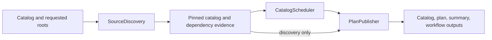

# Pipeline contracts

## Identity records

The executable lock and prepared-source manifest currently use `schema_version: 1`.
Readers reject unsupported versions. Additive diagnostic fields may be introduced
without changing identity semantics. Renaming required fields or changing their
meaning requires a schema revision and reader migration; do not rewrite old evidence.

`PreparedSource` validates source name, version presence, basename-only `.dsc`,
and SHA256 fields. Consumers additionally check the catalog-entry digest, Git
pins, run ID/attempt, source inventory, and actual file hashes. No checksum stored
alongside an artifact is by itself proof of an independent trust root.

`BuildTarget` validates suite, architecture, distribution, and immutable profile
names. Snapshot catalogs retain additional target fields for UCA and builder
configuration. Suite and upload distribution are distinct.

## Dependency decisions

Relations preserve alternatives and version operators. Architecture restrictions
use `dpkg-architecture` against the target, not the planner host. Profile terms
within `<...>` are ANDed; separate groups are ORed. Unknown syntax fails planning.
Recognized dpkg/autopkgtest substitutions remain deferred to those tools.

Version comparisons use `dpkg --compare-versions`. A satisfying selected candidate
is preferred; otherwise known archive versions are considered. Unknown external
providers remain an explicit system-archive resolution decision. Virtual Provides,
full Multi-Arch provider selection, and unresolved substvars are not a complete
APT solver and must not be described as such.

Every selected candidate edge records its phase, declaration, and producer.
Cycles retain explicit archive bootstrap decisions. A bootstrap build does not
prove that every package was built against the complete candidate set.

Package remediation must not introduce an unplanned selected build producer.
That case fails with a request to regenerate the plan. Post-repair runtime/test
replanning is not yet complete; this limitation remains on the roadmap.

## Results and promotion

| Record | Meaning |
| --- | --- |
| `PLANNED` | Lock validated without executing a build |
| Build `SUCCEEDED` | Source/binary checks and Lintian gate passed |
| Autopkgtest `PASS` | Reported tests passed |
| `SUPERFICIAL`, `SKIP`, `NO_TESTS` | Distinct coverage limitations accepted by current handoff policy |
| `FAIL`, `INFRA_ERROR`, `BLOCKED` | Failed test or unavailable prerequisite; not readiness |
| Producer `READY` | Successful build and an accepted test outcome for the expected run |
| Remediation `REPAIRED` | Fresh candidate build/test accepted and selected for promotion |

Proposal validation currently accepts PASS, SUPERFICIAL, and NO_TESTS; unlike
handoff readiness, it does not mark SKIP as validated. Preserve this distinction
until the review policy is deliberately changed.

A review suggestion does not mean a patch was applied. In particular,
`review-upstream-patch-overlap` records heuristic evidence while leaving the
quilt series unchanged. Proposals retain `human_review_required` until reviewed;
the flag does not serve as an execution approval mechanism.

## Compatibility

Scripts are command-line adapters. Import reusable Python APIs from
`packagetest`. The advisory `packaging plan` CLI and the candidate handoff
repository builder serve separate planning and execution responsibilities.

## Package remediation responsibilities

Evidence selection preserves priority: missing-import build dependencies, failed
quilt patches and focused upstream hunks, implicated functional tests, then
packaging files and moved-path candidates. Source context shares one character
budget; model prompts also retain bounded feedback from the preceding attempt.

`ProposalPlanner` normalizes, validates, and batches model decisions, then renders
a cumulative patch against the original prepared tree. Decision identities are
counted before rendering, and accepted changes are retained when a failed build
or test exposes a different failure. Duplicate decisions and unchanged failures
retain their existing stop conditions.

`CandidateExecutor` runs a fresh build followed by autopkgtest only when the build
returns zero and records `SUCCEEDED`. Test acceptance uses the classified result;
the raw test exit code is recorded separately. It never replaces canonical output
directories. `ArtifactPromoter` accepts only a candidate with successful build
and accepted test outcomes and performs the canonical directory replacement.
Replacement is sequential, not a transaction across both directories.

`RepairProgress` records attempts and unchanged-evidence retries;
`RemediationSession` supplies wall-clock and attempt budgets. Model timeouts keep
partial output and stop immediately, subprocess timeouts stop the session, and
other errors use the unchanged-evidence retry budget. Report rendering does not
make execution or promotion decisions.

## Nightly planning responsibilities

`SourceDiscovery` owns a private catalog copy for one discovery pass. Injected
ref and metadata readers pin and inspect each selected source once. Required
candidates and unsatisfied upstream requirements expand the selection; inspection
failures remain per-source evidence. Packaging source preference and archive
version decisions are unchanged by scheduling.

`CatalogScheduler` owns graph state for one scheduling pass. It records dependencies
outside the selection as archive bootstrap edges, removes internal cycle edges,
then restores reviewed mandatory candidate edges. Unresolved mandatory cycles and
wave counts above capacity fail planning. Candidates in earlier waves replace
cycle bootstrap edges when available. Sources and wave members are sorted;
input catalogs are not mutated. `plan_catalog` remains the reusable entry point.

`PlanPublisher` stamps run metadata and writes `catalog.json`, then hashes those
exact bytes into `plan.json`. It renders the summary and emits workflow outputs
without choosing dependencies. Discovery-only output has empty waves and phase
`source-discovery`; dependency levels are deferred until source preparation.
`--no-resolve` expands mandatory candidates without network access and remains
an offline inspection mode, not a buildable frozen catalog.

